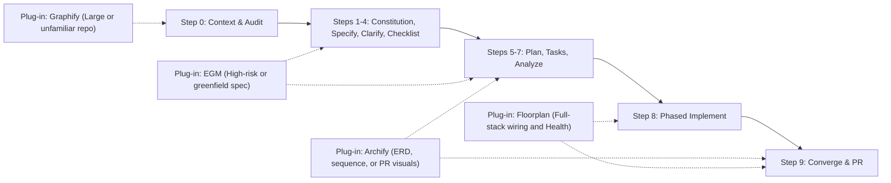

# Spec-Kit Playbook Template

A reusable **Spec-Kit (`0 → 9`) engineering workflow template** built for solo portfolio apps and team repositories alike. It combines:

- **Size Profiles (`S / M / L`)** so small bugfixes stay fast and greenfield builds get deep gating.
- **A Master AI Roster** ([ai-roster.md](./ai-roster.md)) mapping Tool + Exact Model + Effort Level + `Orchestrator` placement + the Two-Brain Rule (`Author ≠ Auditor`).
- **A Two-Layer Skill Architecture** ([skills-catalog.md](./skills-catalog.md)) separating Universal Core Skills from App-Type Skill Packs (capped at `≤ 3` skills per turn).
- **Four Conditional Tool Plug-ins** ([tools-playbook.md](./tools-playbook.md)) — **Graphify**, **EGM**, **Floorplan**, and **Archify** — wired in only when a ticket profile warrants them.

---

## Unified Architecture (Core Spine + 4 Plug-in Gates)



---

## Quickstart

1. **Create your playbook workspace:** Click **Use this template** on GitHub (or clone this repo as a sibling folder next to your target app repository).
2. **Configure project context & tracker:**
   ```bash
   cp project-context.template.md project-context.md
   cp tracker.template.md tracker.md
   ```
   Fill in `{{PLACEHOLDERS}}` in `project-context.md` (stack, paths, quality gates) and toggle on only the Layer 2 Skill Packs your app uses.
3. **Review your AI Roster:** Open [ai-roster.md](./ai-roster.md) once to verify your active models and effort levels. Step prompts reference **Roles** rather than hardcoded models so upgrades take one line.
4. **Generate a feature playbook:**
   ```bash
   ./scripts/init-feature.sh FEAT-001 user-profiles M
   ```
   This creates `playbooks/feat-001-user-profiles.md` pre-configured for the chosen Size Profile (`S`, `M`, or `L`).

---

## Size Profiles (`S / M / L`)

| Profile | Best For | Active Spec-Kit Steps | Plug-in Gates |
| :--- | :--- | :--- | :--- |
| **`S` — Small** | Bugfixes, small UI tweaks, copy/style fixes | `2 (Specify) → 5 (Plan) → 8 (Implement) → 9 (Converge)` | None (zero ceremony overhead) |
| **`M` — Medium** *(default)* | Standard full-stack features, new endpoints/screens | Full `0 → 9` | **Floorplan** at Steps 8–9 (+ **Archify** if DB schema or auth changes) |
| **`L` — Large** | Greenfield products, auth/DB overhauls, unfamiliar repos | Full `0 → 9` | **Graphify** (Step 0) + **EGM** (Pre-Step 5) + **Archify** (Step 5/9) + **Floorplan** (Step 8/9) |

---

## Local-vs-Git Workspace Boundary Rule

Keep engineering scaffolding cleanly separated from application source code:

- **Recommended (Sibling Layout):** Keep `.specify/`, `specs/`, and `playbooks/` in a parent workspace directory *outside* your target app repository so application PRs contain only production code, tests, docs, and the PR summary.
- **Alternative (Inside an App Repo):** Add `.specify/`, `specs/`, `playbooks/`, `floorplan/`, `graphify-out/`, and `.archify/` to `.git/info/exclude` (local-only, never committed).
- **Curated Visuals Only:** Only copy finished **Archify** diagrams into `docs/diagrams/` inside your app repo when intentionally sharing visuals in docs or portfolios.

---

## Repository Index

| File | Purpose |
| :--- | :--- |
| [ai-roster.md](./ai-roster.md) | 4-Tier Brain Architecture, `Orchestrator` guidance, Step `0–9` Tool + Model + Effort roster |
| [skills-catalog.md](./skills-catalog.md) | Layer 1 Universal Core Skills + Layer 2 App-Type Skill Packs + `≤ 3` skill budget rule |
| [tools-playbook.md](./tools-playbook.md) | Trigger rules, commands, and git hygiene for Graphify, EGM, Floorplan, and Archify |
| [project-context.template.md](./project-context.template.md) | Single source of truth per project (stack, paths, quality gates, active skill packs) |
| [tracker.template.md](./tracker.template.md) | Master backlog tracker + per-spec `0–9` step progress tables |
| [templates/constitution.starter.md](./templates/constitution.starter.md) | Stack-agnostic Articles `I–VII` starter constitution with SemVer governance |
| [templates/feature-playbook.template.md](./templates/feature-playbook.template.md) | Parameterized `0–9` feature playbook with Artifact Map, prompts, and Telemetry Log |
| [templates/pr-summary.template.md](./templates/pr-summary.template.md) | Evidence-separated PR template (`SOURCE / LOCAL / CI / STAGING / ACCEPTANCE`) |
| [guides/git-and-pr-techniques.md](./guides/git-and-pr-techniques.md) | Trunk-based branching, rebase/squash-merge recovery, `.git/info/exclude`, solo vs. team PR flow |
| [guides/token-hygiene.md](./guides/token-hygiene.md) | Hard context resets, `≤ 3` skill cap, deterministic gates, Effort escalation, telemetry |
| [scripts/init-feature.sh](./scripts/init-feature.sh) | Generator script to scaffold `playbooks/<id>-<slug>.md` for Profile `S`, `M`, or `L` |

---

## Publishing as a GitHub Template Repository

1. Push this repository to your personal GitHub account (`main` branch).
2. Open **Settings → General** on GitHub.
3. Check **Template repository** so every future project starts cleanly via **Use this template**.
